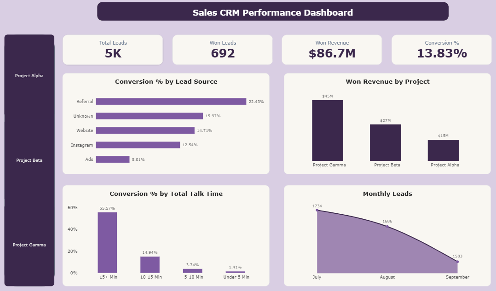

# Sales CRM Performance Analysis

An end-to-end data analysis project: synthetic CRM data generated, profiled, cleaned and analyzed in PostgreSQL, then visualized in Power BI.

**Goal:** find what drives lead conversion and revenue for a sales team.

**Tools:** PostgreSQL, SQL, Power BI

## Data

Synthetic CRM data with 4 tables (row counts after cleaning):

| Table | Rows | Description |
|---|---|---|
| leads | 5,004 | Customer leads with source, project, status, deal value, first response time |
| calls | 10,010 | Calls per lead with status and duration |
| managers | 8 | Sales managers and their teams (A and B) |
| tasks | 4,339 | Follow-up tasks with due and completion dates |

Period: July to September 2026.

## Data Cleaning

Raw data was messy on purpose. All fixes are in `03_cleaning.sql` and exposed through `_clean` views.

| Stage | Issue | Fix |
|---|---|---|
| Standardizing | Mixed-case names, inconsistent phone formats | `INITCAP`, digits-only phones formatted as `+1 999 999 9999` |
| Standardizing | Typos in source, status, call status, team (e.g. "insta", "referal", "no answer", "Team B ") | `CASE` mapping + `TRIM`/`LOWER` |
| Duplicates | Exact copies: 30 leads, 100 calls, 60 tasks | `SELECT DISTINCT` |
| Duplicates | 36 near-duplicate leads (same email) | `ROW_NUMBER()` by email, kept the first |
| Blanks | Missing name (50), source (120), status (50) | Filled with `'Unknown'` |
| Blanks | Missing email, phone, deal value, dates | Kept as `NULL` (real CRM gaps, not errors) |
| Impossible values | 50 response times (negative or over 24h), 35 deal values (0 or over 250K), 15 due dates in 1900 | Set to `NULL` |
| Relationships | 15 orphan calls, 40 calls before lead creation, 100 answered/missed vs duration conflicts, 79 task manager mismatches, 40 tasks completed before lead creation | Flagged with `is_` columns, not deleted |

## Key Findings

1. **Talk time is the strongest signal.** Conversion rises from 1.4% (under 5 min of calls) to 55.6% (15+ min). Leads with 15+ minutes convert about 40x better.
2. **Referrals beat ads.** Referral converts at 22.4%, ads at only 5.0%, despite similar lead volume.
3. **Project Gamma earns the most.** 44.5M won revenue, nearly 3x Alpha (15.5M), thanks to a bigger average deal (181K vs 75K).
4. **A third of tasks are never completed** (32-35% for every manager), a team-wide follow-up problem.
5. **Response speed and manager skill matter little.** Conversion is flat across response times (13-15%) and managers are close (11-16%).

Note: the call and talk time results show a strong link, not proof of cause. Leads close to buying may simply get more calls.

## Recommendations

- **Coach managers to spend longer on calls.** Aim for 15+ minutes of total talk time per lead.
- **Shift ad budget toward referrals.** Referral leads convert at 4x the rate of ads.
- **Prioritize Project Gamma** and look into why Alpha deals are small and convert less.
- **Enforce task follow-up.** A third of tasks are never done, so add reminders or reviews.

## Dashboard

Built in Power BI with 4 KPI cards, 4 charts and a project filter. File: `06_sales_dashboard.pbix`

## Project Structure

| File | Purpose |
|---|---|
| `01_create_tables.sql` | Table setup |
| `02_data_profiling.sql` | Data profiling |
| `03_data_cleaning.sql` | Data cleaning |
| `04_create_views.sql` | Clean views |
| `05_EDA.sql` | Business questions and analysis |
| `06_sales_dashboard.pbix` | Power BI dashboard |
| `sales_crm_dashboard.PNG` | Dashboard screenshot |
| `calls.csv`, `leads.csv`, `managers.csv`, `tasks.csv` | Synthetic CRM data |
